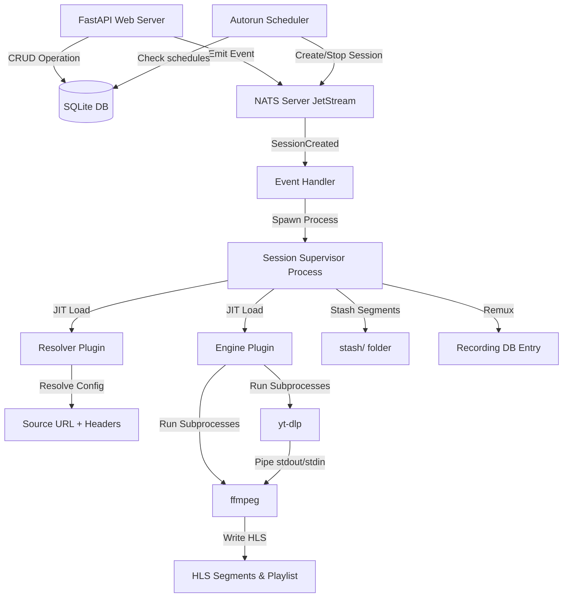

# Mirrorr Agent Context (`AGENTS.md`)

This file provides a highly optimized, high-precision context map of the **Mirrorr** codebase. It is designed to give LLM agents immediate, complete architectural understanding using minimal context window tokens.

---

## 0. Coding Style & Principles (READ FIRST)

**This is the most important section. All code written for Mirrorr MUST follow these principles.**

### Mandatory first step for new sessions
Before any coding, **read AGENTS.md in full** and confirm understanding. If it is stale or missing coverage for the task, report what is outdated or missing before proceeding. Do not assume — verify against the actual source files if anything is uncertain.

### Less is more
More code is often bad code. Elegant, compact code is preferred over verbose, ceremonial code. Every line must earn its place. If something can be inlined, inline it. If a class can be a function, make it a function. If a dataclass can be a plain dict, use a dict. Only introduce abstraction when it removes real complexity — not when it just makes things look more "designed".

### Reliability through condensation
The goal is to condense reliability into the least amount of classes and data structures possible. Each thing should have one concern and solve it well. The same semantical role split across many things is useless complexity. More complexity isn't bad, but less is more **when it doesn't remove value**.

### Batching concerns when it makes sense
If multiple things share the same lifecycle, the same connection, or the same output path — batch them together. Don't create separate classes, methods, or data structures for each if they can share infrastructure without losing clarity.

### Elegance over ceremony
Unnecessary docstrings, excessive error handling, and method-per-concern extraction are bad code. Code should be self-documenting through clear naming and minimal structure. Docstrings are good **only when they add information not obvious from the code itself**.

### Type safety, not type noise
Type hints are important. `TypeVar`, `ClassVar`, and other advanced typing constructs are used when they serve the code — not for decoration. If a type hint doesn't help the caller, don't add it.

### Compaction principle
> "more code is often bad code"

When refactoring, always check: does this change add lines that earn their place, or is it ceremony? Prefer removing lines over adding them. The best code change is one that reduces line count while preserving or improving behavior.

### No over-abstraction
Don't create context wrappers, shortcut methods, or intermediate dataclasses just because a "senior pattern" says so. If `context.bus.emit()` works, don't wrap it in `context.emit()`. If `bus` can be passed directly, don't wrap it in a context object.

### Line count reporting
After every editing session, report the number of lines added and removed across all changed files.

### Keep AGENTS.md up to date
After any meaningful edit to the codebase, update this file to reflect the changes. This includes:
- New or removed files in the directory structure
- New or changed features, models, events, or settings
- Updated status of implemented vs unimplemented features
- Any architectural changes that agents need to know about

AGENTS.md is the source of truth for agents working on this codebase. If it's stale, agents will make incorrect assumptions.

---

## 1. Project Essence & Direction
**Mirrorr** is a self-contained, event-driven live stream management service. It resolves stream configurations, downloads/records live streams using pluggable engines (`yt-dlp` piped to `ffmpeg`), generates live HLS playlists (`.m3u8` + `.ts` segments), and records high-frequency process telemetry.

**Long-term intent:** A self-hosted, API-driven live stream management backbone. Given stream sources (Twitch, YouTube, IPTV m3u, etc.), Mirrorr ingests them, transcodes/copies into HLS, optionally records to disk, and serves the segments over HTTP. Controlled entirely via REST API with WebSocket real-time event forwarding to a frontend.

**Current state:** The architecture and core pipeline (resolve → ingest → transcode → HLS) work. Autorun scheduling, recording lifecycle with stash/remux, and the autorun scheduler are implemented. CLI (`mirrorr` entry point, full argparse in `src/mirrorr/main.py`) and dev-only HTTP file serving (`--dev-serve-files` mounts `content_dir`) are implemented.

---

## 2. Core Architecture & Lifecycle



1. **Boot** (`MirrorrCore._boot()`): Creates directories, syncs the bundled default plugins, initializes SQLite DB, locates FFmpeg, syncs plugins to DB, starts local NATS server, connects NATS client bus, starts autorun scheduler.
2. **API & Events**: FastAPI CRUD endpoints write to `{base_dir}/mirrorr_data.db` and emit typed events (e.g., `SessionCreated`) over NATS.
3. **Process Isolation**: NATS handler intercepts `SessionCreated` and spawns an independent OS process (`multiprocessing.Process`) running `SessionSupervisor`.
4. **JIT Plugin Loading**: Supervisor dynamically loads Resolver and Engine plugins from the filesystem, verifying SHA-256 hashes against the database.
5. **Ingestion Pipeline**: Resolver resolves config → `Source` (URL + headers). Engine (e.g., `yt-dlp_piped`) runs `yt-dlp` piped to `ffmpeg`, writing HLS segments + `.m3u8` playlist to the session folder.
6. **Recording**: When recording is active, a background stash task copies the oldest 10% of segments to a `stash/` folder before ffmpeg deletes them. On session end, stash + remaining segments are concatenated via ffmpeg into an MP4, the session folder is moved to `recordings/`, and a `Recording` DB entry is created.
7. **Autorun Scheduler**: Polls every `autorun_check_interval` seconds. Creates sessions for autoruns whose `start_time` has arrived — the new session **inherits the autorun's access** (its grants, owner users and owner groups, copied once at creation) — and stops sessions linked to autoruns whose `end_time` has passed. **A slot starts at most one session, ever**: the new row carries an `idempotency_key` (`autorun:<id>:slot:<start_time>`) under a UNIQUE index, so a duplicate tick, a re-armed start or a second core cannot double-spawn — the key is checked before the savepoint and enforced by the index (Oct 21 2026). **One slot is one session even when its source falls back** (Oct 24 2026, superseding the per-rung sessions of Oct 23): the spawned session carries the autorun's whole `fallback_profile_ids` chain in `capture_plan`, and the supervisor itself runs those profiles in order — each a *capture* with its own engine/resolver/config/retry policy (a fallback is a *different source*) and its own folder (`autoruns/<snake_case_name>` for the session's own capture, `autoruns/<snake_case_name>_capture<n>` for the rest; `live_folder_holder` refuses a primary folder another live session writes into) — merging every capture's remuxed artifact into **one** recording named after the capture that produced media. A capture that never becomes playable hands over to the next, so the row turns `failed` only once every source has been tried; the console's session detail lists them (`captures`, `capture_plan`). **Only the autorun's newest session speaks for it** (Oct 23 2026): `update_session` propagates a session's status to its autorun only when that session is the newest of the autorun's sessions, and a session whose resolve keeps throwing is terminal after `_MAX_RESOLVE_FAILURES` (3) attempts — with `retry: always` a stale channel name otherwise looped forever. At boot, an orphaned session is always failed; its autorun's `orphan_policy` then decides whether a fresh session replaces it while the window is still open (`retry`) or not (`fail`, the default).
8. **Telemetry**: Supervisor captures subprocess stdout/stderr to log files and samples process resource usage (CPU, RAM) at 1 Hz per managed process; `_wire_telemetry` coalesces those samples into **one** `session.{id}.telemetry` frame per second (`services/telemetry.py`), which the console renders as the live process readout (Oct 16 2026). Raw per-process subjects (`session.{id}.telemetry.<proc>`) are never forwarded to WS clients. Like every other WS frame it reaches that session's **audience** — every `VIEW` holder, not just the account that created it (Oct 21 2026).

---

## 3. Entry Points & Configuration

### CLI Usage
```bash
uv run mirrorr --help            # full argparse: -c/--config, --host, --port, --nats-port,
                                # --base-dir, --hls-window, --segment-duration, --web-url,
                                # --dev-serve-files, --dev-seed-admin
```
Installed as `mirrorr = "mirrorr.main:main"` (`[project.scripts]`).

### Programmatic Usage
```python
from mirrorr.core import MirrorrCore
from mirrorr.startup.config import MirrorrSettings

settings = MirrorrSettings(base_dir="./my_data")
core = MirrorrCore(settings)

# Any of these:
await core.run_async()          # async, blocks until shutdown
core.run_blocking()             # sync, calls asyncio.run internally
task = core.to_task()           # returns asyncio.Task[None]
```

### Environment File Usage
```python
settings = MirrorrSettings.create_from_env(".env")
core = MirrorrCore(settings)
core.run_blocking()
```

### `MirrorrSettings` (shipped with Mirrorr)
All paths default relative to `base_dir`. `MirrorrSettings.create_from_env()` reads env vars / .env file via `pydantic-settings`.

| Setting | Default | Purpose |
|---|---|---|
| `base_dir` | `.` | Root for all Mirrorr state |
| `content_dir` | `{base_dir}/content` | Video data + sessions |
| `autoruns_dir` | `{content_dir}/autoruns` | Scheduled session storage |
| `recordings_dir` | `{content_dir}/recordings` | Permanent recording storage |
| `engines_dir` | `{base_dir}/plugins/engines` | Engine plugin .py files |
| `resolvers_dir` | `{base_dir}/plugins/resolvers` | Resolver plugin .py files |
| `sync_default_plugins` | `True` | Copy the bundled built-ins into the plugin dirs on boot (only when missing/changed); `False` = manage plugins yourself |
| `companions_dir` | `{base_dir}/companions` | Companion process log dir (companions are spawned on demand, never installed) |
| `nats_server_dir` | `{base_dir}/nats-server` | Local NATS binary |
| `binaries_dir` | `{base_dir}/binaries` | Downloaded binaries |
| `db_file` | `{base_dir}/mirrorr_data.db` | SQLite database |
| `nats_port` | `4222` | NATS server port |
| `smoke_test_timeout_s` | `30.0` | Bound on a resolver's `smoke_test` readiness probe (Oct 15 2026) |
| `hls_window` | `60` | Sliding HLS manifest duration in seconds |
| `segment_duration` | `10` | Individual segment duration in seconds |
| `autorun_check_interval` | `10` | Seconds between autorun schedule checks |
| `use_system_ffmpeg` | `False` | Use $PATH ffmpeg |
| `use_system_nats` | `False` | Use $PATH nats-server |
| `api_host` | `localhost` | Uvicorn bind host |
| `api_port` | `8000` | Uvicorn bind port |

---

## 4. Domain Models

### Vocabulary — `session` means exactly one thing

**A session is one supervised attempt to capture one live source into one recording** — the `Session` row and everything that hangs off it: its supervisor process, its folder, its lifecycle, its captures, its access rows. Nothing else in the codebase may be called a session, and the word is never used unqualified for a database unit of work.

| Word | Means | Where it lives |
|---|---|---|
| **session** | the domain record + its whole lifecycle (one live source → one recording) | `models.Session`, `/sessions`, `SessionStatus`, `SessionSupervisor`, `session_folder`, `session_urls` |
| **db** | one SQLAlchemy unit of work (`AsyncSession`), for the length of one transaction | `_get_db()` dependency, `db: AsyncSession` params, `get_db()` context manager |
| **db factory** | the `async_sessionmaker` that produces a `db` | `storage/database.py`, `container.db_factory` |
| **capture** | one profile's run inside a session — its own engine/resolver/config/retry policy | `capture_plan`, `captures`, `_begin_capture` |
| **attempt** | one retry of the capture currently running | `attempts`, `retry_attempts` |
| **recording** | the finished media artifact and its `Recording` row | `services/recording.py`, `/recordings` |
| **supervisor** | the OS process that runs a session | `SessionSupervisor`, `handlers._supervisors` |

Third-party names are not ours to rename and stay as they are: `AsyncSession` (SQLAlchemy's class), the `sqlmodel.ext.asyncio.session` import path, `subprocess(..., start_new_session=True)`, httpx/aiohttp `ClientSession`. A local typed `AsyncSession` is still called `db`.

All models in `src/mirrorr/storage/models.py` using **SQLModel** (SQLAlchemy + Pydantic). Enums (`SessionStatus`, `AutorunStatus`, `UserRole`, `ResourceType`, `Capability`) live in `src/mirrorr/storage/enums.py`. Plugin ABCs (`EngineInterface`, `ResolverInterface`, `Source`, `Capabilities`) live in `src/mirrorr/plugin_api/interfaces.py`; retry schemas + helpers in `src/mirrorr/plugin_api/retry.py`.

| Model | Purpose | Status |
|---|---|---|
| **Resolver** | Plugin that resolves config → `Source` (URL + headers). `search_schema` holds the JSON Schema of its optional discovery filter model. | Implemented |
| **ResolverSource** | A named, saved `(resolver_id, resolver_config)` pair — the "resolver-only profile", reusable in any profile/session/autorun. Live: loading one fills the consumer's resolver section. | Implemented |
| **Engine** | Plugin that consumes `Source`, runs subprocesses to write HLS. Has `retry_modes_schema` dict (JSON Schema per mode). | Implemented |
| **Profile** | Ties a Resolver + JSON config to a default Engine. Has `retry_mode`/`retry_config` as defaults for sessions using this profile. | Implemented |
| **Session** | One supervised attempt to capture one live source into one recording — the row outlives the process, so it is the identity (status, access, history), not the run. Links Profile + Engine. Has `recording`, optional `retry_mode`/`retry_config` overrides (None = inherit from profile), `retry_attempts`, `session_urls`, `idempotency_key` (nullable, UNIQUE) which pins one autorun slot to at most one session, and the capture pair: `capture_plan` (the profiles this session tries in order — its own capture then any fallbacks; `[profile_id]`, or `[None, *fallbacks]` when a manual request named an engine + resolver, where `None` is that engine+resolver capture) and `captures` (what each tried source did: profile/engine/resolver names, status, reason, attempts, `seconds`/`bytes`, `merged` once its media is in the recording). A fallback never spawns a second session (Oct 24 2026). | Implemented |
| **Autorun** | Scheduled session with `start_time`/`end_time`, `recording`, optional `retry_mode`/`retry_config` overrides, links Profile + Engine, `orphan_policy` (`fail` \| `retry`) deciding what a boot does with its mid-flight session, and `fallback_profile_ids` — an ordered list of further profiles copied into the spawned session's `capture_plan` and tried by that one session in turn (a fallback is a *different source*, so its capture takes that profile's engine/resolver/config/retry policy whole; Oct 24 2026). | Implemented |
| **Recording** | Denormalized snapshot of a completed recording (profile/engine/resolver names, path, metadata, `size_bytes`). | Implemented |
| **Source** | Pydantic model: `url` + optional `headers` dict | Used by Resolver → Engine handoff |
| **Capabilities** | Pydantic model: `can_record` / `can_stream` | Used by Engine |
| **DiscoveryItem / DiscoveryPage** | Dataclasses (`src/mirrorr/plugin_api/interfaces.py`): one discovery result (`id`, `title`, `config`, optional `subtitle`/`image`/`description`/`meta`) and a page of them with an opaque `next_cursor`. | Implemented |
| **Companion / CompanionSpec** | A resolver's optional companion process (`ResolverInterface.companion`) — a `Companion` subclass + its config, declared in `src/mirrorr/plugin_api/companion.py`. The core spawns it on demand and shares it across sessions (`src/mirrorr/services/companions.py`). | Implemented |
| **NoRetry / RetryAlways / RetryCount / RetryOnExitCode** | Retry mode schemas (Pydantic models). Defined in `src/mirrorr/plugin_api/retry.py`, used by `EngineInterface.retry_modes` | Implemented |
| **`build_retry_modes_schema`** | Generates `{mode: {schema, default_params}}` dict for DB/API transport | Implemented |
| **`get_retry_delay` / `get_retry_max_attempts`** | Helpers that extract retry policy from mode+config | Implemented |
| **SessionStatus** | Enum (`src/mirrorr/storage/enums.py`): `initializing`, `stream_pending`, `active`, `recording`, `terminating`, `remuxing`, `finalizing`, `completed`, `failed` | Implemented |
| **AutorunStatus** | Enum (`src/mirrorr/storage/enums.py`): `scheduled`, `active`, `recording`, `terminating`, `remuxing`, `finalizing`, `completed`, `failed` | Implemented |
| **ResourceType** | Enum (`src/mirrorr/storage/enums.py`): `session`, `profile`, `autorun`, `recording`, `source`, `user` | Implemented |
| **Client** | API client identified by hashed API key, linked to many Users | Implemented |
| **User** | Username + password auth with roles (`admin`/`user`), linked to many Clients | Implemented |
| **ClientUser** | Many-to-many join table: Client ↔ User | Implemented |
| **ResourceAccess** | A **capability** grant naming one principal: a user (`username`, `group_id` NULL) or a group (`group_id`, `username` NULL) — `(resource_type, resource_id, username, capability)` and `(resource_type, resource_id, group_id, capability)` are each UNIQUE, and SQLite treats NULLs as distinct so each constraint is vacuous for the other kind's rows. `capability` is a `Capability` enum (`VIEW`, `OPERATE`, `EDIT`, `DELETE`, `SHARE`, `EXPORT`); the owner (`requester_user_token == username`) and admins hold all six implicitly, everyone else holds only the rows granted — through themselves or through a group they belong to. **VIEW is the base capability** — any grant implies it, so a non-empty `POST /shares` list is stored with `VIEW` added, while `VIEW` itself implies no other capability (the implication is one-way). `username` matches `User.username` with **no FK** (same convention as `requester_user_token`), so a deleted user leaves an inert grant and a deleted owner surfaces as `owner_missing`; a group grant follows the group by `group_id` (renaming is free) and is dropped with it. Grants cascade away with their resource (and on `deleteUser`). Every pre-2026-10-16 row backfilled to `VIEW`, and that migration also adds a `VIEW` row beside every pre-existing non-`VIEW` grant (Oct 16 2026). | Implemented |
| **Group** | A named set of users that can own items and hold grants: `(id, name UNIQUE, display_name, system, created_at)`. `system` marks the reserved `everyone` row (`EVERYONE_GROUP_NAME`), seeded idempotently by `ensure_db`, never creatable/renamable/deletable — its membership is **implicit** ("every authenticated user") and resolved in the predicate, so it has no member rows and a new user needs no hook. Created/renamed/deleted only through the admin `/groups` routes; deleting a group clears its memberships, grants and owner rows in one transaction. | Implemented |
| **GroupMember** | `(group_id, username)`, UNIQUE, **no FK** on `username` (same convention as `resource_access.username`) — a deleted user's row is inert until `deleteUser` clears it. | Implemented |
| **ResourceOwnerGroup** | An **additive group owner** of one resource: `(resource_type, resource_id, group_id)`, UNIQUE. Ownership is additive by design — the single requester owner is untouched (the crown is `requester_user_token`, or `requester_group_id` when a group holds it — at most one of the two, set only through `PUT /admin/resources/{type}/{id}/owner` with a `username` or a `group_id`) and every member of every row's group holds all six capabilities, exactly like the owner. Keyed by `group_id`, so renaming a group needs no cascade. `everyone` may own an item (the console states it loudly as "Everyone is an owner: every account, including future ones, gets every permission on this item — delete included."). | Implemented |
| **ResourceOwnerUser** | An **additive user owner** of one resource: `(resource_type, resource_id, username)`, UNIQUE. A user owner holds all six capabilities exactly like the requester and the item lists for them; the requester owner is untouched. `username` has **no FK** (the `resource_access` convention), so a deleted user's row is inert until `deleteUser` clears it, and the row is dropped with the resource. Add/remove through `PUT\|DELETE /shares/{type}/{id}/owner-user/{username}` (Oct 17 2026). | Implemented |
| **EventSubscription** | Tracks which user owns interest in which resource, for notification routing | Implemented |
| **Notification** | Notification toast for a user, triggered by major events (started, stopped, etc.) | Implemented |

---

## 5. Directory Structure
```
mirrorr-core/
├── pyproject.toml               # [project.scripts] mirrorr = "mirrorr.main:main"
├── src/mirrorr/
│   ├── main.py                  # CLI entry point (argparse): MirrorrSettings.create_from_env → MirrorrCore
│   ├── core.py                  # MirrorrCore: boot, run_async, run_blocking, to_task, shutdown
│   ├── di.py                    # DI container singleton
│   ├── _version.py              # __version__ single source of truth
│   ├── static_files/            # Bundled player pages (player.html, outplayer.html, vlc.html)
│   ├── default_plugins/         # Bundled plugins shipped with the package
│   │   ├── engines/yt_dlp_piped.py      # yt-dlp → pipe → ffmpeg → HLS
│   │   └── resolvers/static.py          # Passthrough URL + headers from config
│   ├── plugin_api/              # Canonical plugin interfaces (imported by plugin authors)
│   │   ├── interfaces.py        # EngineInterface, ResolverInterface ABCs, Source, Capabilities, DiscoveryItem/DiscoveryPage
│   │   ├── companion.py         # Companion ABC + CompanionSpec + sibling() loader (companion process base)
│   │   └── retry.py             # Retry schemas (NoRetry/RetryAlways/RetryCount/RetryOnExitCode) + helpers
│   ├── api/                     # FastAPI web server
│   │   ├── api.py               # App init, exception handlers, router registration
│   │   ├── auth.py              # Auth infrastructure: password hashing, user/client resolution, subscription/notification helpers
│   │   ├── jwt.py               # JWT token creation and validation
│   │   ├── dependencies.py      # DB handle DI, AuthState (client + user + is_admin), require_auth/require_admin
│   │   ├── privileged.py        # Admin-only field declarations + per-principal response/OpenAPI stripping
│   │   ├── schemas.py           # Pydantic request/response models (incl. source + discovery)
│   │   ├── ws.py                # WebSocket event mirroring + notification push
│   │   └── routers/
│   │       ├── auth.py          # Registration, login, user management, client management, notifications
│   │       ├── crud.py          # Dynamic CRUD router generator + session control endpoints + /sources CRUD + /resolvers/{id}/discover
│   │       ├── import_export.py # Bundle-based import/export
│   │       ├── groups.py        # Admin-only group CRUD + membership (the reserved `everyone` group is sealed)
│   │       └── logs.py          # Session logs + recording progress endpoints
│   ├── event_bus/               # NATS-based event system
│   │   ├── event.py             # Event class definitions (Pydantic + NATS subjects), incl. resolver_source.*
│   │   ├── nats.py              # NatsRegistry: connect, emit, subscribe, on()
│   │   ├── protocol.py          # EventBus abstract protocol
│   │   └── handlers/
│   │       ├── __init__.py      # Auto-imports all modules in this directory
│   │       └── handlers.py      # Process registry + lifecycle handlers + notification creation
│   ├── services/                # Process supervisors and background tasks
│   │   ├── managed_process.py   # Subprocess wrapper + event-driven lifecycle + telemetry
│   │   ├── companions.py        # Companion discovery/spawn/lease (scan the process table; no registry)
│   │   ├── process_bus.py       # In-process async event bus (pub/sub)
│   │   ├── session_supervisor.py# Per-session orchestrator (runs in own OS process)
│   │   ├── session_runner.py    # Subprocess entry points (runner, main)
│   │   ├── session_lifecycle.py # update_session/delete_session/update_autorun + remove_session_folder
│   │   ├── session_helpers.py   # Dir setup, URL building, DB loading
│   │   ├── recording.py         # Segment stash + remux-to-MP4 lifecycle
│   │   ├── telemetry.py         # Coalesce per-process samples into one session-level frame
│   │   ├── permissions.py       # has_capability/require_capability — the single capability predicate
│   │   └── autorun_scheduler.py # Background loop that starts/stops autorun sessions
│   ├── startup/                 # Boot sequence and environment checks
│   │   ├── config.py            # MirrorrSettings (Pydantic model + create_from_env)
│   │   ├── ensure_db.py         # Schema sync: create tables + add/remove columns
│   │   ├── ensure_engines.py    # Thin wrapper: engine-specific extractors for generic sync
│   │   ├── ensure_resolvers.py  # Thin wrapper: resolver extractors (+ search_schema) for generic sync
│   │   ├── ensure_plugins.py    # Generic plugin sync: filesystem ↔ DB + JIT loader
│   │   ├── ensure_ffmpeg.py     # Locates/bundles FFmpeg binary
│   │   ├── ensure_nats_server.py# NatsServerManager: downloads/runs local NATS server
│   │   ├── api_bootstrap.py     # Uvicorn server startup
│   │   └── logging.py           # Loguru config with process-aware formatting
│   └── storage/                 # Database layer
│       ├── database.py          # create_db_engine(settings) → (engine, db_factory)
│       ├── models.py            # SQLModel schemas (+ backward-compat re-exports), incl. ResolverSource
│       ├── enums.py             # SessionStatus, AutorunStatus, UserRole, ResourceType
│       └── crud.py              # Generic async CRUD helpers
├── deploy/                      # nginx-http.conf, nginx-https.conf
├── docs/                        # general-client-specification.md
└── .env.example                 # Documented env template (copy to .env)
```
Runtime state (gitignored, created under `base_dir`): `content/`, `plugins/`, `binaries/`, `nats-server/`, `mirrorr_data.db*`.

---

## 6. Coding Conventions & Style Rules

### Python Style
- **Python 3.14+** (uses `type | None` union syntax, not `Optional[]`).
- **`loguru`** for all logging. Never use `print()`. Use `logger.info()`, `logger.error()`, `logger.success()`, etc.
- **`loguru` color shortcuts**: Use `logger.opt(colors=True)` with `<green>`, `<yellow>`, `<blue>` tags for highlighted values.
- **Type hints** are expected on function signatures and class attributes. Use modern syntax (`list[str]`, `dict[str, Any]`, `str | None`).
- **`async/await`** throughout. The entire DB layer, API, NATS client, and event handlers are async.
- **Naming is load-bearing**: `session` is the domain `Session` and nothing else (see §4 Vocabulary). A database unit of work is `db` / `db_factory`, a supervisor process registry is `_supervisors`. If a variable needs the word "session" for something that is not the domain record, it has the wrong name.

### Architecture Patterns
- **Plugins are interfaces**: Engines implement `EngineInterface`, Resolvers implement `ResolverInterface` (both ABCs in `src/mirrorr/plugin_api/interfaces.py`). Default plugins live in `src/mirrorr/default_plugins/` and are synced into `{engines_dir}` / `{resolvers_dir}` at boot (rewritten only when missing or changed); operator plugins live in those dirs directly. Set `sync_default_plugins=False` (`SYNC_DEFAULT_PLUGINS=false`) to skip the built-ins entirely — the dirs are still created, and boot still requires at least one engine and one resolver.
- **Plugins are stateless**: They are loaded JIT via `importlib`, instantiated, used, and discarded. No persistent state in plugins.
- **Plugins are hash-verified**: `ensure_plugins.py` provides a generic `sync_plugins_db()` that `ensure_engines.py` and `ensure_resolvers.py` call with plugin-specific extractors. JIT loaders verify hashes before execution.
- **Plugins declare schemas for their config**: Resolvers expose `config_model → model_json_schema()`. Engines expose `retry_modes → dict[str, type[BaseModel]]` → serialized via `build_retry_modes_schema()`. Both are stored as JSON columns on their DB rows.
- **Resolvers may expose discovery**: Optional `ResolverInterface` members — `discovery_model` (Pydantic filter model, synced to `Resolver.search_schema` by the resolver extractor), `discovery_has_catalog`, and `async browse(params, cursor, context)` / `async search(query, params, cursor, context)` returning `DiscoveryPage`. `POST /resolvers/{id}/discover` runs `browse` when no query is given and `search` when one is; both return items a source can be saved from.
- **Resolvers may declare a companion process**: Optional `ResolverInterface.companion` returns a `CompanionSpec` (a `Companion` subclass + its session-independent config). The resolver loads the companion module with `sibling(__file__, "<module>")` (a sibling `.py` in `resolvers/`), returns the spec, and in `resolve` calls `await acquire(spec, context.companions_dir)` for `(base_url, lease)`, holding the lease on `self` and closing it in `stop`. There is no registry: `services/companions.py` discovers live companions by scanning the process table for the `--mirrorr-companion` marker and probing `/__companion__` (identity = name + source hash + config), reuses a match, or spawns one via `ManagedProcess` (detached, `start_new_session`) and arbitrates a spawn race by lowest pid. A lease is a *shared* `flock` on the companion's lock file (`{companions_dir}/{name}-{identity-hash}.lock`), so the kernel owns the holder count — a crashed holder cannot leak a process and the count cannot drift; companions self-reap once no shared lock has been held for `IDLE_TTL`. Companion names must be globally unique (`_companion_validator` in `ensure_resolvers.py`).
- **Resolvers may define a startup probe**: Optional `ResolverInterface.smoke_test(source, config, context)` — async, **raise to fail**, base implementation a **no-op** (existing plugins unaffected). The supervisor calls it **unconditionally** right after `resolve()`, bounded by `asyncio.wait_for(…, smoke_test_timeout_s)` (default 30 s, added Oct 15 2026). A raise or timeout is **terminal — the retry policy is not consulted** (Oct 16 2026): the probe is the resolver's verdict on the *source*, so the same config cannot be expected to resolve differently and `retry: always` must not loop on a dead channel. The row is kept `failed` with the reason in `attempts[-1].reason`; a `resolve()` failure, by contrast, stays an ordinary retryable crash — but only up to `_MAX_RESOLVE_FAILURES` (3) failures in a row (Oct 23 2026), after which the attempt is terminal too: a stale channel name does not start matching on the next loop, and without the bound a `retry: always` session kept the slot busy so the autorun never advanced to its next fallback profile.
- **The stream itself has a deadline**: the startup gate's playlist poll gives up after `STREAM_READY_TIMEOUT_S` (30 s) and the attempt is terminal the same way — no retry policy, straight to `failed` (Oct 23 2026). A source whose engine never writes a segment is dead (the probe only vouches for the *resolver's* read), and a session parked in `stream_pending` forever kept its autorun's slot busy, so no fallback rung ever fired. **A terminal failure keeps what it recorded**: `_fail()` remuxes the attempt's segments into a recording attached to the `failed` row (`remuxing` → `failed`, folder kept) instead of discarding them with the folder — the F1 rungs hold real minutes of race when they die mid-session.
- **Sources are the "resolver-only profile"**: `ResolverSource` is just a named `(resolver_id, resolver_config)` pair, served by a dedicated `/sources` router in `crud.py` (ownership-scoped, `PrivilegedRoute`, cursor pagination) with `resolver_source.{created,updated,deleted}` events. It is live config to load, not a link to a running thing.
- **Retry modes are engine-driven**: Each engine inherits a default `{none, always, count}` retry set via `EngineInterface.retry_modes`. Engines can override this property to customize available modes. The supervisor takes the policy of the **capture** it is running (`_capture_settings["retry_mode"]` / `["retry_config"]` — the session's own snapshot for capture 1, the fallback profile's own values for a later capture, resolved at creation by `_resolve_capture_target`) and loops that capture's attempt loop until success, stop, or exhaustion. `count` is the number of **retries**, not attempts: the supervisor's `attempt` is 1-based, so `should_retry` gives up only when `attempt > count` (`count=3` ⇒ up to four attempts). Retry params come from plugin-serialised JSON, so `delay`/`count`/`codes` are coerced with sane fallbacks rather than trusted (Oct 20 2026).
- **Events are typed Pydantic models**: Each event is a class with a `ClassVar[str]` subject. Register handlers with `@bus.on(MirrorrEvent.EVENT_NAME)`.
- **Long-running work happens in separate OS processes**: The event handler for `SessionCreated` spawns `multiprocessing.Process`. The supervisor must be fully self-contained.
- **DB schema auto-syncs**: Add/remove columns in SQLModel classes and `ensure_db.py` handles ALTER TABLE at startup. No manual migrations. A constraint change SQLite cannot ALTER is applied by a full table rebuild, which pins `PRAGMA foreign_keys=OFF` **and** `PRAGMA legacy_alter_table=ON` for its duration (both saved and restored in a `finally`): without them the `RENAME TO _old_<t>` rewrites every child's `REFERENCES` to the `_old_*` name (schema-level, **even with zero child rows**) and the final `DROP TABLE _old_<t>` trips it — `legacy_alter_table` alone is not enough (Oct 15 2026). The rebuild first drops the renamed table's named indexes — the `RENAME` carries their names, so the model's `CREATE INDEX` collided (`index ix_… already exists`) and died before the data copy, leaving a silent truncation once the restart's matching schema skipped the rebuild; an abandoned `_old_<t>` is **rescued** into the live table (`INSERT OR IGNORE`, columns common to both, only when the live table is empty or smaller) instead of dropped, and the `ADD COLUMN` pass is skipped for any table already queued for rebuild (Oct 16 2026).
- **Audit hardening (Oct 20 2026)**: a password over bcrypt's 72-byte limit is rejected at the schema *and* raises in `hash_password` (bcrypt silently truncated, so two passwords could authenticate the same account), and `verify_password` returns `False` instead of raising on an over-long candidate. The login rate-limit key uses the **last** `X-Forwarded-For` hop — the one the nearest proxy appended — because the first is client-supplied. An import validates and applies only the requester's **own** profiles (`_profiles_owned_by`): a bundle naming a profile it does not own used to link to the other user's row. `subscribe_requester` **commits** — the request session closes without one, so the `event_subscriptions` insert was rolled back and a new item's owner never received its notifications or per-resource WS events. **It takes `commit=False` for a caller that already owns the transaction** (Oct 23 2026): `autorun_scheduler._spawn_session` runs inside `_tick`'s `begin_nested()` savepoint, so the unconditional commit ended the enclosing transaction mid-savepoint and the next statement (`inherit_access`) raised `Can't operate on closed transaction inside context manager` — the session row had already been committed by that point, so the autorun lost its session, the watchdog failed it 33 s later, and the slot key blocked any retry. Every other call site sits in a request whose session closes uncommitted, hence the default. A duplicate `SessionCreated` (retry, double emit) is ignored while the first supervisor process is alive instead of spawning a second one. `ManagedProcess` reads its subprocess pipes in 64 KiB chunks and splits on `\r` as well as `\n`: `StreamReader.readline()` caps a line at 64 KiB and raised on ffmpeg's `\r`-separated stats block, which killed the reader and then blocked the child on a full pipe (a live session frozen with no exit event). `SESSION_STARTED` fires on the first transition into `active` **or** `recording` — a recording session never passes through `active`, so those runs emitted no start event. `GET /sessions/?autorun=<id>` filters server-side (the access predicate still applies; an unknown id is an empty page), so the autorun detail no longer pages the whole history to find its run. `NatsServerManager.start` refuses a port held by a server it did not spawn rather than attaching to it, and fails fast if the child exits during the wait loop.
- **All dependencies are passed, never global**: `MirrorrSettings` is passed to every subsystem. No module-level singletons for settings, DB engine, or db factory. The only singleton is the NATS event bus (`bus`).
- **Event mapping lives in the CRUD router**: `event_map` dict maps model classes to their `(created, updated, deleted)` event tuples. Domain models do NOT carry event references.
- **Supervisor-owned fields are protected**: `PUT /sessions/{id}` strips `status`, `recording`, `retry_attempts`, `started_at`, `ended_at`. Clients must use dedicated control endpoints.
- **WebSocket delivery is capability-gated, not subscriber-gated**: `api/ws.py` resolves every frame to its **audience** with `permissions.viewer_usernames(db, type, id)` — the same rows `has_capability` consults (requester owner user or crown group, `resource_owner_users`, `resource_owner_groups`, and any `resource_access` grant, `everyone` expanded to all accounts) — and sends only to those connections; an admin receives everything. The result is cached ~10 s per `(type, id)` in `_Audience`, so a revoke can lag one window. Broadcast CRUD subjects are resolved from their payload `id` (`_event_resource`); a subject the process does not model (`resolver_source.*`, `proc.*`) is dropped; a frame whose row is gone goes nowhere, except `*.deleted`, which only an admin hears because the row and its access rows cascade together. `EventSubscription` no longer gates this stream — it remains the notification target list (`subscribe_requester`, `notify_subscribers`). The notification relay drops the coalesced `.telemetry` sample, which is a live readout rather than a notification and used to refetch the bell once a second. Verified live against the running unit with a minted admin/user pair (Oct 21 2026).
- **Admin-only fields are declared once**: `api/privileged.py` holds the single field→model map; `PrivilegedRoute` strips those fields from every response and `strip_openapi` removes them from the schema served to a non-admin. Extend by adding to the map — never by branching on `is_admin` in a route. The browser half is a second build (`admin.html`), not a runtime role check.
- **Capabilities gate every action**: `services/permissions.py` — `has_capability(db, auth, obj, capability)` / `require_capability(...)` — is the one predicate every router calls. Map: list rows / detail / `GET /sessions/{id}/logs` / recording progress → `VIEW`; `stop` / `enable_recording` / `disable_recording` → `OPERATE`; `update_*` → `EDIT`; `delete_*` → `DELETE`; export profile/autorun → `EXPORT`; the `/shares/` routes → `SHARE`. **Reusing an item in one of your own is `VIEW`** (Oct 23 2026): `profile_id` in a `POST /sessions/`, `POST /autoruns/` or `PUT /autoruns/{id}` body (`_load_visible_profile`, was `_load_owned_profile` on `EDIT`) and `save_{session,autorun}_as_profile` all copy out of the item and leave it untouched — requiring `EDIT` made a profile shared with `everyone` unusable for starting a session while protecting nothing, since `ProfileResponse` already ships the same `resolver_config` to every `VIEW` holder. **`DELETE /profiles/{id}` detaches rather than destroys what others built from it**: rows the profile's owner did not create (their `requester_user_token`/`requester_group_id` differs) get `profile_id = NULL` and are counted as `deleted.detached`, because their engine/resolver/config were copied into their own columns at creation; the owner's own standalone sessions and autoruns still cascade. Owner and admin hold all six; **VIEW is the base capability — any grant implies it (a `VIEW` check passes on the presence of *any* row), and no other capability implies another** (one-way). **Principals are users and groups**: a grant counts when it names the caller or a group they are a member of, and an owner *group* (`resource_owner_groups`) or an owner *user* (`resource_owner_users`) confers all six exactly like the requester owner — the reserved `everyone` group is a member of everything by definition, and its membership is resolved in the predicate rather than stored (Oct 16 2026). The old `crud._require_owner_or_admin` and `_has_read_grant` are **deleted** — `_require_read_access` survives only as a `has_capability(..., VIEW)` wrapper, and lists go through `_get_paginated_for_user`'s **grant EXISTS** (deliberately unfiltered by capability, since any grant implies VIEW) **plus an owner-row EXISTS — a user owner, or a group the caller belongs to** (Oct 16 2026). **A session spawned by an autorun inherits the autorun's access** — its `resource_access` grants, `resource_owner_users` and `resource_owner_groups` are copied onto the new session at creation (`permissions.inherit_access`, called by `autorun_scheduler._tick`), so whoever can see the scheduled item sees what it produced; the copy is a snapshot, so later edits to the autorun do not reach a session already created (Oct 17 2026).

### Import Conventions
- Settings: `MirrorrSettings` passed via constructor. No module-level import of a settings singleton.
- Database: `from mirrorr.storage.database import create_db_engine` → called with settings, returns `(engine, db_factory)`.
- Models: `from mirrorr.storage.models import Session, Profile, ...`
- Enums: `from mirrorr.storage.enums import SessionStatus, ...`
- Plugin ABCs: `from mirrorr.plugin_api.interfaces import EngineInterface, ...`
- Events: `from mirrorr.event_bus.nats import bus` and `from mirrorr.event_bus.event import MirrorrEvent`.
- CRUD: `from mirrorr.storage.crud import get_all, get_by_id, create, update, delete`

### File Organization
- **`src/mirrorr/`** contains all core application code (API, event bus, services, storage, startup, core).
- **`src/mirrorr/default_plugins/`** contains bundled plugins shipped with the package.
- **`src/mirrorr/plugin_api/`** contains the canonical plugin interfaces (`interfaces.py`, `retry.py`) imported by plugin authors.
- **`src/mirrorr/static_files/`** contains bundled player pages served by the API (`player.html`, `outplayer.html`, `vlc.html`), copied into a session folder only when it is first created; `player.html` autoplays muted, plays HLS through the `<hlsjs-video>` media element (no hand-rolled hls.js setup), and injects a native 10-second rewind (`<media-seek-button seconds="-10">`) as the control-bar sibling immediately before the play button — the packaged skin renders its bar in a shadow root and exposes no slot for extra controls, so it is inserted by shadow-DOM lookup keyed on the public `media-play-button` element and is simply omitted if a future skin release stops rendering one. Since Oct 16 2026 squaring is **frame-only**: the light DOM sets `--media-border-radius`/`--media-video-border-radius` to 0, and the blanket `*{border-radius:0!important}` shadow-root injection was removed — the packaged skin's own chrome radii (its 99px `--media-control-radius` pills for bar, buttons, slider, menus) stay untouched.
- **User plugin dirs** (`plugins/engines/`, `plugins/resolvers/`) are created at runtime relative to `base_dir`.
- **Dev file serving**: `dev_serve_files=True` mounts `content_dir` as static files (dev only); production serves `/content/` via nginx (`deploy/`).
- **`binaries/`** is for downloaded NATS server and FFmpeg binaries (gitignored).

---

## 7. Known Issues & WIP Gaps

### Implemented (formerly gaps — now done)
- **CLI**: `mirrorr` console script (`src/mirrorr/main.py`, full argparse: `--host/--port/--nats-port/--base-dir/--hls-window/--segment-duration/--web-url/--dev-serve-files/--dev-seed-admin`).
- **HTTP file serving**: dev mode via `dev_serve_files` (mounts `content_dir`); production via nginx `deploy/` configs.

### Structural Concerns
- **Import/export bundles do not carry sources** — `import_export.py` has no `sources` array yet (deliberate deferral; bundles without sources still apply).

---

## 8. Key File Quick Reference

| File | What it does |
|---|---|
| `src/mirrorr/main.py` | CLI entry point (`mirrorr` script). Argparse → `MirrorrSettings.create_from_env` → `MirrorrCore.run_blocking()`. |
| `src/mirrorr/core.py` | `MirrorrCore` class: boot, run_async, run_blocking, to_task, shutdown. **Main API surface.** |
| `src/mirrorr/startup/config.py` | `MirrorrSettings` (Pydantic model) + `create_from_env()` factory. Includes `web_url`, `dev_serve_files`, `nats_url`. |
| `src/mirrorr/storage/models.py` | All domain models (SQLModel tables + backward-compat re-exports), incl. `ResolverSource`. |
| `src/mirrorr/storage/enums.py` | `SessionStatus`, `AutorunStatus`, `UserRole`, `ResourceType` (incl. `source`). |
| `src/mirrorr/plugin_api/interfaces.py` | `EngineInterface`/`ResolverInterface` ABCs + `Source`/`Capabilities` + `DiscoveryItem`/`DiscoveryPage`. |
| `src/mirrorr/plugin_api/companion.py` | `Companion` ABC (base for companion processes: `/health` + `/__companion__` identity + flock-based self-reap), `CompanionSpec`, `sibling()` loader. |
| `src/mirrorr/services/companions.py` | `scan()` (process-table discovery) + `acquire()` (reuse or spawn via `ManagedProcess`, race-arbitrated) + `Lease`. |
| `src/mirrorr/plugin_api/retry.py` | Retry schemas (`NoRetry`/`RetryAlways`/`RetryCount`/`RetryOnExitCode`) + `build_retry_modes_schema` + delay/attempt helpers. |
| `src/mirrorr/storage/database.py` | `create_db_engine(settings)` → `(engine, db_factory)`. |
| `src/mirrorr/event_bus/nats.py` | `NatsRegistry` singleton (`bus`): connect, emit, on(), start_subscriptions(). |
| `src/mirrorr/event_bus/event.py` | Event class definitions. Each has a NATS subject string. |
| `src/mirrorr/event_bus/handlers/handlers.py` | Process registry + lifecycle handlers: spawns/kills supervisors, handles autorun deletion. Creates notifications for major events. |
| `src/mirrorr/services/session_supervisor.py` | Per-session orchestrator. Loads plugins JIT, resolves source, starts engine, manages retries. Composes `RecordingManager` for stash/remux. Builds `session_urls` for static files + HLS playlist. Coalesces the attempt's per-process 1 Hz samples into one `session.{id}.telemetry` frame per second (`_wire_telemetry` + `services/telemetry.py`, Oct 16 2026). **Runs the session's captures** (Oct 24 2026): `run()` walks `capture_plan`, `_begin_capture` points the supervisor at one source and folder (the first runs the session's own capture, a later one loads its profile whole via `load_profile_capture`), `_run_capture` is one capture's attempt loop under that capture's retry policy, and `_close_capture` tears down and remuxes that capture's segments (`remux_capture`) into a scratch artifact — a capture that never becomes playable hands over to the next, so a fallback never spawns a second session. `_do_remux_and_finalize` merges every artifact into **one** recording, named after the capture that produced media (`producer`), and marks those captures `merged`. The startup gate's ready/lifecycle wait and its cancel-and-park loop are one `try/finally`, so a raise from the playable `update_session` (e.g. the row deleted concurrently) still reaps all four tasks before the exception reaches the retry loop (Oct 15 2026). `_wait_for_playlist` ends on a non-empty `stream.m3u8` **or the 30 s deadline** (`STREAM_READY_TIMEOUT_S`, raised as `TimeoutError` and handled by `_preflight_failed`); `_fail()` is the one terminal path — it cleans up and remuxes anything already recorded into a recording attached to the `failed` row; and the folder guard (`live_folder_holder`) refuses a folder another live session holds before the `initializing` publish (Oct 23 2026). Capture folders are scratch: they go after the merge (and after a non-recording completion), and stay only on `failed`, whose folder is kept for inspection. |
| `src/mirrorr/services/recording.py` | `RecordingManager` dataclass: segment stash during streaming, `remux_capture()` (one capture's segments → one MP4 in its own folder, no move, no Recording row — the input to the session's merge), `finalize(artifacts, producer)` (copy one artifact or concat several in capture order, a failed merge keeping the longest, then move the folder to `recordings/` and create the Recording row), `probe_duration`, `use_folder`. Composed into `SessionSupervisor`. |
| `src/mirrorr/services/autorun_scheduler.py` | Background loop: creates sessions for due autoruns (`_spawn_session`, shared with the boot retry, copying the autorun's grants + owner users + owner groups onto the new session via `inherit_access` and stamping `slot_key(autorun[, "retry-<orphan>"])` as the session's `idempotency_key`), writes the autorun's whole source chain into the session's `capture_plan` (`fallback_chain` = the autorun's own profile then `fallback_profile_ids`, deduped — the session runs them itself, so one slot is one session even when it falls back), stops sessions when autorun end_time passes (via NATS request/reply with feedback). |
| `src/mirrorr/services/managed_process.py` | Subprocess wrapper with event-driven lifecycle, telemetry polling, log capture. |
| `src/mirrorr/services/process_bus.py` | In-process async pub/sub bus. Topic-based message passing via `asyncio.Queue`. |
| `src/mirrorr/services/session_runner.py` | Subprocess entry points (runner, main). The runner polls its shutdown event instead of parking a thread in `Event.wait()` — `asyncio.run()` joins the default executor on close, so a parked thread kept the process alive after `supervisor.run()` returned and left a stopped session's supervisor behind. |
| `src/mirrorr/services/session_lifecycle.py` | `update_session`/`delete_session`/`update_autorun` helpers, plus `remove_session_folder()` and `remove_recording_folder()` — the single owners of a deleted session's / recording's content-folder removal (`_content_folder()` keeps both to folders inside `content_dir`, never the reserved `autoruns`/`recordings` roots themselves; `_kept_artifacts()` refuses a folder any kept recording's row still names). A session's removal leaves a folder a kept recording lives in alone; a recording's removal takes its own `recordings/<name>` folder whole — the media, the player shells and the logs (Oct 24 2026; the router had only deleted the row, so every deleted recording left its bytes on disk for ever). `fail_orphaned_sessions` fails every row left in `LIVE_STATUSES` by a dead core, then `_retry_orphaned_autoruns` starts one replacement per orphan whose autorun has `orphan_policy='retry'` and an open window (key `…:retry-<orphan id>`, so one orphan is never retried twice). `live_folder_holder(settings, folder, session_id)` answers the id of another **live** session already writing into that folder (or `None`) — the supervisor's write-collision guard (Oct 23 2026). |
| `src/mirrorr/services/session_helpers.py` | Dir setup, URL building, DB loading — `load_session_from_db` for the session's own capture, `load_profile_capture` for a later capture (that profile's engine/resolver/config/retry + the JIT-loaded interfaces, Oct 24 2026). |
| `src/mirrorr/services/permissions.py` | `has_capability(db, auth, obj, capability)` / `require_capability(...)` — the single capability predicate every router calls; owner and admin hold all six, everyone else only their `resource_access` rows — matched on the caller **or a group they belong to** (`group_holds(username, group_id_column)` builds that clause for both grant and owner-group queries, resolving the sealed `everyone` group by its `system` flag, never a hardcoded id), plus any **owner row** naming the caller — a `resource_owner_users` username or a group they belong to. An owner *group* or owner *user* confers all six. `inherit_access(db, source, target)` copies one resource's grants + owner users + owner groups onto another (a session inherits its autorun's). `viewer_usernames(db, type, id)` is the socket layer's audience — the same rows expanded to usernames, `None` when the row is gone, admins deliberately excluded (callers short-circuit them). |
| `src/mirrorr/startup/ensure_plugins.py` | Generic plugin sync: `load_plugin_jit()` + `sync_plugins_db()` with extractors. |
| `src/mirrorr/startup/ensure_engines.py` | Thin wrapper: `load_engine_jit()` + `sync_engines_db()` with engine-specific field extractors. |
| `src/mirrorr/startup/ensure_resolvers.py` | Thin wrapper: `load_resolver_jit()` + `sync_resolvers_db()` with resolver extractors (incl. `search_schema`). |
| `src/mirrorr/startup/ensure_db.py` | `ensure_db(engine)` — schema auto-migration (add/remove columns); a constraint-drift rebuild runs FK-safe (dual pragma, see §6), drops the renamed table's named indexes before recreating it, and rescues any `_old_<t>` sibling. `_ensure_indexes` then creates every model-declared index: `ALTER TABLE` cannot add one, so an `index=True` column created after its table had none (fixed Oct 21 2026). |
| `src/mirrorr/startup/ensure_nats_server.py` | `NatsServerManager(settings)` — downloads/runs local NATS server binary. |
| `src/mirrorr/api/routers/crud.py` | CRUD router with protected fields + capability-gated access control + session control endpoints (stop, recording enable/disable via NATS request/reply). **Every gate calls `has_capability(db, auth, obj, Capability.X)`** (`services/permissions.py`); `_require_read_access` is now a `VIEW` wrapper and lists go through `_get_paginated_for_user`'s grant EXISTS (any grant implies VIEW). Deleting a session reclaims it: `_reclaim_session()` stops the supervisor *then* removes its folder (a 504 from the stop request is tolerated — the reclaim settles it either way), and the removal itself belongs to `session_lifecycle.remove_session_folder()`. Deleting a recording removes the row *then* its `recordings/<name>` folder through `remove_recording_folder()` — the order matters, because that guard reads the kept rows and the deleted recording must not block its own removal (Oct 24 2026). Subscriptions auto-created on resource creation. **A manual session carries fallbacks too** (Oct 24 2026): `CreateSessionRequest.fallback_profile_ids` goes through the same `_load_fallback_chain` an autorun uses (`subject="session"` for its 422 copy) and is written as the session's `capture_plan`, own capture first — `[profile_id, *fallbacks]`, or `[None, *fallbacks]` when the request named an engine + resolver, since `None` is the supervisor's "the session's own settings" capture. Also hosts the `/sources` router (`ResolverSource` CRUD) and `POST /resolvers/{id}/discover`. |
| `src/mirrorr/api/auth.py` | Auth infrastructure: password hashing (`bcrypt`), API key hashing, client/user resolution, subscription/notification helpers. |
| `src/mirrorr/api/jwt.py` | JWT token creation (`create_access_token`) and validation (`decode_access_token`) using HS256. |
| `src/mirrorr/api/routers/auth.py` | Registration, login (`/auth/register`, `/auth/login`), `/auth/me`, password change, admin user/client management, notifications. Also hosts the **admin resource** routes — only `GET /admin/resources` and `PUT …/{type}/{id}/owner` are admin-only (server-computed `label`, `owner_group_id`, `owner_missing`, `viewer_count`, `owner_users`/`owner_groups`/`grant_groups` name lists, read-only `system` rows for engines/resolvers). The owner route takes **exactly one** of `{username}` or `{group_id}` — the crown is one user or one group — and answers `{resource_type, id, owner, owner_group_id}` (`owner` is the label: the username, or the owning group's name). The sharing surface is the separate capability-gated `shares_router` at `/shares/{type}/{id}` (GET returning `owner`/`owner_group_id`/`owner_missing`/`grants` **plus `owner_users`/`owner_groups`/`group_grants`**, POST replace-set, DELETE clear, `SHARE`), with the group twins `POST\|DELETE /shares/{type}/{id}/group/{group_id}` and the additive owner routes `PUT\|DELETE /shares/{type}/{id}/owner-group/{group_id}` and `PUT\|DELETE /shares/{type}/{id}/owner-user/{username}` (adding either never touches the requester owner); the three old `/admin/resources/{type}/{id}/access*` routes are removed (404). |
| `src/mirrorr/api/routers/groups.py` | Admin-only group CRUD: `GET /groups` (each group with `member_count` + `members`; the sealed `everyone` row reports every user), `POST /groups`, `PATCH /groups/{id}`, `DELETE /groups/{id}` (clears memberships + grants + owner rows in one transaction), `PUT /groups/{id}/members` replace-set. `everyone` is rejected for create/rename/delete/member-edit; names are trimmed, unique, 1..64 chars. |
| `src/mirrorr/api/routers/import_export.py` | Bundle-based import/export. |
| `src/mirrorr/api/routers/logs.py` | Session logs + recording progress endpoints. |
| `src/mirrorr/api/dependencies.py` | DB handle DI, `AuthState` (client, user, is_admin), `require_auth`/`require_admin`/`get_auth`/`ws_auth` dependencies. |
| `src/mirrorr/api/privileged.py` | `PRIVILEGED_FIELDS` (field → model map), `PrivilegedRoute` (response stripping), `strip_openapi` (schema stripping). Single source of truth for admin-only data. |
| `src/mirrorr/api/ws.py` | WebSocket event mirroring + real-time notification push (`/ws/notifications`). **Both relays deliver each frame to the resource's audience** — `permissions.viewer_usernames`, cached ~10 s per `(type, id)` in `_Audience` — never to every connection, and never to a connection that cannot `VIEW` the row: broadcast CRUD subjects are resolved from their payload `id`, unmodelled subjects (`resolver_source.*`, `proc.*`) are dropped, per-process telemetry subjects are skipped, and a frame whose row is gone is dropped except `*.deleted` (admin only — the row and its access rows cascade together). The notification relay additionally drops the coalesced `.telemetry` sample (a live sample is not a notification, and forwarding it refetched the bell 1 Hz). Auth via cookie / `X-API-Key` / `Authorization: Bearer` / `?api_key=`; failure closes `4001` (Oct 21 2026). |
| `src/mirrorr/default_plugins/engines/yt_dlp_piped.py` | Example engine: `yt-dlp` piped to `ffmpeg` → HLS output. |
| `src/mirrorr/default_plugins/resolvers/static.py` | Example resolver: passthrough URL + headers from config. |
